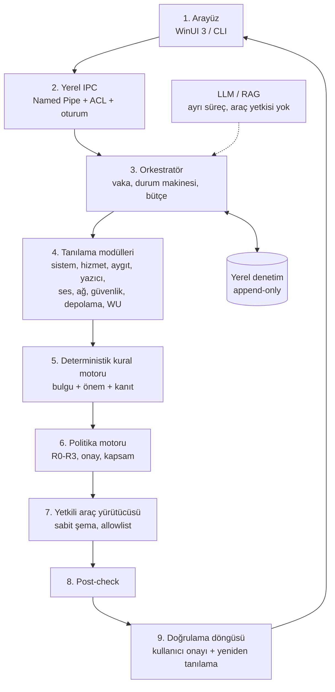
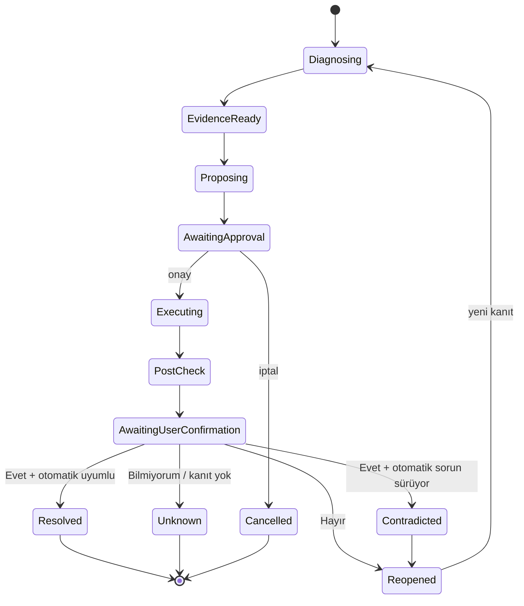

# YAPAIR Mimarisi

**Sürüm:** 3.0 — genel Windows tanılama ve onarım platformu  
**Durum:** Sprint 1/2 uygulandı (salt okunur tanılama + doğrulama)  
**Öncelikli platform:** Windows 10/11; Windows Server desteklenen sürümleri

> Kapsam notu: Önceki mimari belgesi yazıcı MVP'sine odaklanıyordu. Ürün kapsamı, kullanıcı kararıyla **Windows'ta karşılaşılan tüm sorun alanlarına** genişletildi. Yazıcı modülü ilk derin dikey dilim olarak korunur; ürün sınırı değildir.

## 1. Tasarım tezi

En iyi sonuç, mümkün olan en fazla işlemi otomatik yapan ajan değildir. En iyi sonuç:

1. Yerel ve doğrulanabilir kanıt toplayan,
2. Kanıtı deterministik kurallarla bulguya çeviren,
3. Riski ve geri alma sınırını açıklayan,
4. Yalnızca onaylanan dar yetkili aracı çalıştıran,
5. Sonucu bağımsız post-check ve kullanıcı onayıyla doğrulayan,
6. Çözülmezse güvenli biçimde duran veya farklı kök nedeni araştıran

bir ajandır. LLM; niyet anlama, açıklama ve aday playbook önerme rolündedir. LLM'nin işletim sisteminde serbest komut çalıştırma yetkisi yoktur.

## 2. Katmanlar



### Katman sorumlulukları

| Katman | Sorumluluk | Yetki |
|---|---|---|
| Arayüz | Sorun girişi, bulgu kartları, onay ve sonuç butonları | Standart kullanıcı |
| IPC | UI ↔ servis; şema, oturum, replay koruması | Kullanıcı SID'siyle sınırlı |
| Orkestratör | Vaka durumu, modül seçimi, timeout, yeniden tanılama | Yetki yok; koordinasyon |
| Modüller | Salt okunur kanıt toplama | Düşük yetki tercih edilir |
| Kural motoru | Bulgu üretimi, kanıt eşikleri | Yetki yok |
| Politika motoru | Risk, onay, kapsam, yasaklar | Yetki verir/reddeder |
| Araç yürütücüsü | Sabit araçları çalıştırma | En düşük gerekli yetki |
| Post-check | Sistem son durumunu okuma | Salt okunur |
| Doğrulama | Otomatik sonuç + kullanıcı onayı | Yetki yok |
| LLM/RAG | Açıklama, aday öneri | Araç çağrısı yok |

**Güven sınırı:** LLM ve web/RAG katmanı politika motorunu veya araç yürütücüsünü doğrudan çağıramaz. LLM çıktısı yalnızca yapılandırılmış adaydır; araç kimliği ve parametreleri katalogdan çözülür.

## 3. Alan modülleri

Her modül aynı sözleşmeyi uygular:

```text
ModuleDefinition
- module_id
- domain
- version
- read_only
- timeout
- required_permissions
- checks()
- findings()
- limitations()
```

| Modül | Kanıt kaynakları | Örnek bulgular |
|---|---|---|
| `system` | WMI işletim sistemi, bellek, önyükleme | Düşük bellek, bekleyen yeniden başlatma |
| `services` | `Win32_Service`, ServiceController | `service_not_running`, `service_disabled` |
| `devices` | `Win32_PnPEntity`, `Win32_PrinterDriver` | `device_configuration_error`, sürücü hatası |
| `printers` | `Win32_Printer`, `Win32_PrintJob`, portlar, Spooler | `printer_offline`, `printer_error_state`, kuyruk |
| `ipp` | IPP 1.1 `Get-Printer-Attributes` (isteğe bağlı) | `ipp_printer_stopped`, `ipp_device_reason` |
| `audio` | Audiosrv, AudioEndpointBuilder, ses PnP aygıtları | Ses hizmeti durmuş, ses aygıtı hatası |
| `network` | `NetworkInterface`, gateway/DNS yapılandırması | Bağdaştırıcı kapalı, gateway/DNS yok |
| `security` | UAC ve güvenlik duvarı politika anahtarları | `uac_disabled`, `firewall_disabled` |
| `storage` | `Win32_LogicalDisk`, `Win32_DiskDrive` | Düşük disk alanı, disk durumu |
| `windows_update` | CBS/WU reboot anahtarları, hizmet durumu | `pending_reboot` |
| `event_logs` | PrintService/System/Application | `recent_error_events`, `service_crash` |
| *(yol haritası)* `group_policy` | RSoP / ilke anahtarları | Etkin ilke çelişkisi |
| *(yol haritası)* `control_panel` | Ayarlar/Denetim Masası durumu | Yanlış yapılandırma |
| *(yol haritası)* `drivers` | Sürücü kataloğu, imza, uyumluluk | Eksik/uyumsuz sürücü |

Yeni alan eklemek için yeni bir modül, bulgu kuralları, risk matrisi ve kabul testleri gerekir. Bir alandaki yetki diğerine otomatik taşınmaz.

## 4. Veri sözleşmesi

`SystemSnapshot` v1 sürümlenmiş JSON sözleşmesidir (`schemas/system-snapshot.v1.schema.json`). Alanlar:

- `os`, `spooler`, `printers`, `print_jobs`, `ports`, `drivers`, `pnp_devices`
- `event_logs`, `ipp_checks`
- `findings`: deterministik bulgular
- `domains_checked`
- `sources`: her adaptörün `success / partial / unknown / failed / disabled` sonucu
- `evidence`: kaynak, fact, değer, zaman, kalite
- `privacy`, `limitations`

Önemli kurallar:

- Erişilemeyen kaynak **“sorun yok”** değildir; `unknown` veya `failed` olarak raporlanır.
- Her bulgu kaynak, kod, alan, önem, konu, özet, kanıt ve isteğe bağlı playbook kimliği taşır.
- `schema_version` ve `snapshot_id` opaktır; kullanıcı/makine kimliği taşımaz.
- Ham keşif çıktıları varsayılan olarak kalıcı tutulmaz.

### Bulgu modeli

```json
{
  "source": "security",
  "code": "uac_no_consent_prompt",
  "domain": "security",
  "severity": "critical",
  "subject": "UAC",
  "summary": "Yönetici onay istemi kapalı...",
  "evidence": ["ConsentPromptBehaviorAdmin=0"],
  "playbook_id": "security.uac.review.v1"
}
```

`Finding` bir teşhis **adayıdır**; onarım izni değildir.

## 5. Risk ve onay politikası

| Seviye | Örnek | Davranış |
|---|---|---|
| **R0** | Durum okuma, olay/kuyruk/disk inceleme | Otomatik, değişiklik yok |
| **R1** | Spooler/ses hizmetini yeniden başlatma | Kullanıcı onayı; etki ve kesinti açıklanır |
| **R2** | Sürücü kurma, port değiştirme, seçili işleri silme | Açık onay + pre/post-check |
| **R3** | UAC/güvenlik duvarı/grup ilkesi gevşetme, BIOS/firmware | Otomatik değil; uzman açıklaması + ayrı onay; kurumsal politikayla yasaklanabilir |

- UAC'yi kapatmak, güvenlik duvarını devre dışı bırakmak, RPC sertleştirmesini kaldırmak **asla** “güvenli düzeltme” olarak sınıflandırılmaz.
- R2/R3 işlemler mod ne olursa olsun politika kontrolünden geçer.
- Onay, UI'dan gelen bir alan değildir; servis tarafında doğrulanır (IPC katmanı uygulandığında).
- Geri alma garantisi yoksa arayüzde “geri alınabilir” gösterilmez.

Ayrıntılar: [docs/risk-policy.md](docs/risk-policy.md).

## 6. Onarım playbook sözleşmesi

```text
RepairPlaybook
- id, title, domain
- risk (R0-R3)
- requires_approval
- summary
- steps: sabit araç kimlikleri + şemalı parametreler
- preconditions
- post_checks
- rollback (varsa)
```

Kurallar:

- Playbook adımları serbest PowerShell/CMD metni değildir; araç kataloğundaki sabit kimliklerdir.
- LLM `inf_path`, dosya yolu, registry yolu veya URL veremez; yalnızca katalog kimliği seçebilir.
- Her playbook için pozitif, negatif, iptal ve kısmi başarısızlık testi gerekir.
- Playbook, test edilmiş post-check olmadan “tamamlandı” sayılmaz.

Mevcut katalog: `Yapair.Core.Playbooks.PlaybookCatalog` (19 kayıt; hiçbiri çalıştırılmaz). IP değişikliği R2, izinli uygulama açma R1, katalog sürücü kurulumu R2 olarak tanımlıdır.

## 7. Doğrulama döngüsü



- Otomatik post-check ile kullanıcı onayı **birbirini denetler**.
- Kullanıcı “çözüldü” dese bile otomatik kontrol sorun görüyorsa sonuç `contradicted` olur; başarı bildirilmez.
- Kullanıcı “çözülmedi” derse otomatik kontrol temiz olsa bile vaka yeniden açılır; belirti farklı olabilir.
- Yeniden tanılama sayısı sınırlıdır (`MaxAttempts`, varsayılan 2; üst sınır 5).
- Kanıt yoksa `unknown`; asla sessizce “çözüldü” denmez.

Ayrıntılar: [docs/verification-loop.md](docs/verification-loop.md).

## 8. LLM ve RAG sınırı

LLM:

- Türkçe doğal dil mesajından niyet/semptom çıkarabilir.
- Bulguları sade Türkçe açıklayabilir.
- Katalogdan aday playbook önerebilir.
- Resmî kaynak özeti sunabilir.

LLM yapamaz:

- Serbest komut, registry yolu, dosya yolu, URL veya sürücü paketi üretmek.
- Kendi güven skorunu doğrulanmış olasılık gibi sunmak.
- Onay gerektiren işlemi onaylanmış saymak.
- Post-check olmadan başarı bildirmek.
- Web metnini sistem politikası olarak kabul etmek.

RAG ilk sürümde kapalıdır. Açıldığında içerik ayrı araştırma bileşeninde karantinaya alınır; yalnızca yapılandırılmış bulgu döner (URL, başlık, tarih, hata kodu, özet, belirsizlik). Web içeriği tek başına eylem tetikleyemez.

## 9. Uygulama durumu

| Bileşen | Durum |
|---|---|
| Çok alanlı salt okunur keşif | Uygulandı |
| Deterministik bulgu motoru | Uygulandı |
| Şema + redaksiyon | Uygulandı |
| IPP 1.1 (HTTP → HTTPS yönlendirme, isteğe bağlı self-signed) | Uygulandı, canlı test edildi |
| Doğrulama döngüsü + CLI onayı | Uygulandı |
| Playbook kataloğu | Uygulandı (tanım) |
| Yerel vaka veritabanı + normalizasyon + kümeleme | Uygulandı (POC) |
| Makine kimliği (bilgisayar adı + hash HWID) | Uygulandı |
| Merkezî Supabase/PostgreSQL + sync | Planlandı |
| Onarım yürütücüsü / IPC / audit DB | Henüz yok |
| WinUI 3 arayüzü | Henüz yok |
| LLM / RAG | Henüz yok |
| Sürücü kataloğu + imza doğrulama + `pnputil` | Planlandı (R2) |
| Grup ilkesi RSoP, Denetim Masası | Yol haritası |

## 10. Test ve kabul

- Şema doğrulaması her raporda zorunludur.
- Gerçek Windows API'leriyle entegrasyon testleri; salt okunur invariant (Spooler durumu değişmez).
- IPP istek/yanıt ayrıştırma testleri; canlı IPPS testi.
- Doğrulama senaryoları: çözüldü, sürüyor, kanıt yok, kullanıcı çelişkisi, yeniden tanılama.
- Başarısız test gizlenmez; mock veri gerçek sistem çıktısı gibi sunulmaz.

## 11. Sonraki adımlar

1. Onaylı onarım yürütücüsü: R1/R2 araçları, pre/post-check, audit, rollback.
2. Windows servis + Named Pipe IPC; UI'dan onay ve sonuç butonları.
3. WinUI 3 vaka ekranı: bulgu kartları, risk açıklaması, “Onayla / İptal”, “Sorun çözüldü mü?”.
4. Audit DB (SQLite, append-only) ve vaka dışa aktarma.
5. LLM adaptörü (yapılandırılmış çıktı, yerel model seçeneği) ve RAG.
6. Grup ilkesi/RSoP, Denetim Masası ve ses uç noktası modülleri.
7. İmzalı kurulum, güncelleme, kurumsal politika.
