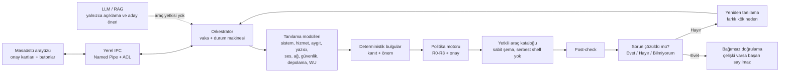

# YAPAIR

### Windows için yapay zekâ destekli tanılama, onarım ve doğrulama ajanı

**Teşhis et. Onar. Doğrula.**

YAPAIR; Windows'ta yazıcıdan sese, ağdan Windows Update'e, UAC/grup ilkesinden aygıt sürücülerine kadar geniş bir sorun yelpazesini yerel kanıtlarla teşhis eden, riski açıklayan ve yalnızca onaylanan sınırlı onarımları çalıştıran bir masaüstü ajanıdır.

> **Durum:** Sprint 1/2 — çok alanlı **salt okunur tanılama**, deterministik bulgular, playbook kataloğu, **çözüm doğrulama döngüsü** ve yerel **vaka veritabanı/kümeleme POC’u** uygulandı. Onarım yürütücüsü, sürücü kurulumu, merkezî Supabase senkronizasyonu, LLM triajı ve Web RAG henüz yoktur. Ayrıntılar: [ARCHITECTURE.md](ARCHITECTURE.md), [docs/verification-loop.md](docs/verification-loop.md), [docs/case-database.md](docs/case-database.md), [docs/driver-management.md](docs/driver-management.md).

## Neden yalnızca yazıcı değil?

İlk derin modül yazıcıdır; ancak ürünün sınırı yazıcı değildir. Aynı kanıt, risk ve onay altyapısı şu alanlarda çalışır:

| Alan | Örnek sorunlar | Durum |
|---|---|---|
| Yazıcılar | Spooler, kuyruk, sürücü, port, kâğıt sıkışması, IPP durumu | Salt okunur |
| Hizmetler | Ses, ağ, RPC, Windows Update, arama hizmetleri | Salt okunur |
| Aygıtlar | PnP hata kodları, eksik/bozuk sürücü, görüntü sürücüsü çökmesi | Salt okunur |
| Ses | Audiosrv/AudioEndpointBuilder, ses aygıtı hataları | Salt okunur |
| Ağ | Bağdaştırıcı, varsayılan ağ geçidi, DNS yapılandırması | Salt okunur |
| Güvenlik | UAC, güvenli masaüstü, güvenlik duvarı profilleri | Salt okunur |
| Depolama | Boş alan, disk durumu | Salt okunur |
| Windows Update | Bekleyen yeniden başlatma, güncelleme hizmetleri | Salt okunur |
| Grup ilkesi / Denetim Masası | Etkin ilke sonucu, denetim masası ayarları | Yol haritası |

LLM hiçbir zaman serbest komut çalıştırmaz. Öneri üretir; politika motoru izin verir; yetkili araç yürütür; bağımsız post-check ve kullanıcı onayı sonucu belirler.

## Hızlı başlangıç

Gereksinim: **.NET 10 SDK** (bu makinede 10.0.401 kurulu) ve desteklenen bir Windows 10/11 sürümü.

```powershell
dotnet build Yapair.slnx
dotnet test  Yapair.slnx

# Tüm sistemde salt okunur tanılama
dotnet run --project src/Yapair.Cli -- discover --format summary

# JSON raporu (şema doğrulamalı)
dotnet run --project src/Yapair.Cli -- discover --pretty --output out/rapor.json

# Seçili yazıcı için IPP durumu (yerel kendinden imzalı sertifika için --ipp-insecure-tls)
dotnet run --project src/Yapair.Cli -- discover --ipp "Kyocera TASKalfa MZ2501ci KX" --ipp-insecure-tls --output out/yazici.json

# Sorun giderildikten sonra doğrula; --ask ile "Sorun çözüldü mü?" onayı
dotnet run --project src/Yapair.Cli -- verify --baseline out/rapor.json --ask

# Onarım playbook kataloğu (salt okunur; hiçbir playbook çalıştırılmaz)
dotnet run --project src/Yapair.Cli -- playbooks --format summary

# Vaka veritabanı POC'u: farklı cümleleri normalize et, aile/alt tür olarak grupla
dotnet run --project src/Yapair.Cli -- cases import --file data/sample-complaints.jsonl
dotnet run --project src/Yapair.Cli -- cases cluster --format summary
```

Derlenmiş CLI:

```powershell
src\Yapair.Cli\bin\Debug\net10.0-windows\yapair.exe discover --format summary
```

### Çıkış kodları

| Kod | Anlam |
|---:|---|
| 0 | Tüm etkin kaynaklar başarılı / doğrulamada sorun çözüldü |
| 2 | Kısmi, bilinmeyen veya doğrulanamayan sonuç |
| 3 | Tanılama başarısız / doğrulamada sorun sürüyor |
| 4 | Şema veya iç hata |
| 64 | Kullanım hatası |
| 130 | Kullanıcı iptali |

## Örnek bulgular

```text
Bulgular (4)
  [KRİTİK] Güvenlik / UAC
    Yönetici onay istemi kapalı (ConsentPromptBehaviorAdmin=0). Uygulamalar sessizce yükseltilebilir.
    Önerilen playbook: security.uac.review.v1 (onay olmadan çalıştırılmaz)
  [UYARI] Sistem / event_log
    Son 24 saatte 7 hata/kritik olay kaydedildi...
  [UYARI] Windows Update / Windows
    Yeniden başlatma bekleyen bir Windows güncellemesi veya bileşen işlemi var...
```

Her bulgu; kaynak, zaman, kanıt, önem derecesi ve varsa playbook kimliği taşır. Bulgu, otomatik onarım izni değildir.

## Mimari



Ayrıntılı katmanlar, güven sınırları ve modül sözleşmeleri: [ARCHITECTURE.md](ARCHITECTURE.md).

## Doğrulama döngüsü

Kullanıcının istediği akış uygulandı:

1. Tanılama ve (onaylıysa) onarım tamamlanır.
2. Otomatik post-check çalışır.
3. Arayüzde **“Sorun çözüldü mü?”** onay kartı gösterilir:
   - **Evet, çözüldü**
   - **Hayır, devam ediyor**
   - **Bilmiyorum**
4. Otomatik kontrol ile kullanıcı onayı çelişirse sonuç **doğrulanmış başarı** sayılmaz.
5. “Hayır” veya çelişki durumunda vaka yeniden açılır; yeni kanıt toplanır ve farklı kök neden araştırılır.
6. En fazla `--max-attempts` (varsayılan 2) tur; sonrasında güvenli duruş ve uzman eskalasyonu.

CLI karşılığı: `yapair verify --baseline <json> --ask`. Arayüzde aynı akış `IVerificationPrompt` arayüzünü uygulayan butonlarla çalışır. Ayrıntılar: [docs/verification-loop.md](docs/verification-loop.md).

## Vaka veritabanı ve kümeleme

Yerel SQLite POC'u, farklı cümlelerle anlatılan benzer sorunları gruplar:

- `machine_label` = bilgisayar adı (destek için etiket)
- `machine_key` = SMBIOS UUID/BIOS serial'ın SHA-256 özeti; **ham HWID saklanmaz**
- Ham kullanıcı metni varsayılan olarak saklanmaz; `--store-raw` açık rıza
- Bilinmeyen metinler token benzerliğiyle gruplanır

```powershell
yapair cases add --text "Yazıcı çevrimdışı"
yapair cases import --file data\sample-complaints.jsonl
yapair cases cluster --format summary
```

Örnek: beş farklı yazıcı ifadesi tek “Yazıcı sorunları” ailesinde, `printer_offline`, `printer_output_failure`, `printer_not_visible` alt türlerinde toplanır.

**Merkezî hedef (planlanan):** 100 PC → yerel outbox → ASP.NET Core API → Supabase PostgreSQL → destek paneli. Ayrıntılar: [docs/case-database.md](docs/case-database.md).

## Sürücü yönetimi (planlanan)

Cihaz kimliğinden sürücü kurulumu **winget/choco/NuGet ile değil**, şu zincirle yapılmalıdır:

```text
HardwareID/VID&PID → resmî kaynak → imza/hash/model doğrulama
→ R2 onay → pnputil /add-driver → post-check → rollback
```

- `winget`: uygulama paketleri için opsiyonel; sürücü için güvenilir değil.
- `choco`: topluluk paketleri; kurumsal ortamda varsayılan kapalı.
- `nuget`: .NET kütüphanesi; sürücü değil.
- LLM `inf_path`/URL veremez; yalnızca katalog `driver_id`.

Ayrıntılar: [docs/driver-management.md](docs/driver-management.md).

## Güvenlik ilkeleri

- Önce kanıt, sonra teşhis, en son eylem.
- Varsayılan olarak salt okunur.
- LLM önerir; politika motoru izin verir; yetkili araç yürütür.
- R2/R3 işlemler onaysız çalışmaz; UAC/güvenlik duvarı/grup ilkesi gibi güvenlik azaltan değişiklikler otomatik değildir.
- Başarı, komutun çıkış koduyla değil post-check ve kullanıcı sonucuyla belirlenir.
- Web içeriği talimat değil, veridir.
- Erişilemeyen kaynak “sorun yok” sayılmaz; `unknown` olarak raporlanır.

Ayrıntılar: [SECURITY.md](SECURITY.md), [docs/threat-model.md](docs/threat-model.md), [docs/risk-policy.md](docs/risk-policy.md).

## Gizlilik

Varsayılan rapor:

- Belge adlarını `<redacted-document>` ile değiştirir.
- IPv4 adreslerini /24 maskeler (`192.168.1.*`).
- Kullanıcı profil adlarını, MAC ve e-posta adreslerini temizler.
- Bilgisayar adı, kullanıcı adı, alan adı, belge içeriği ve seri numarası toplamaz.
- PnP örnek kimliği son ekini kaldırır; yalnızca veri yolu ve donanım kimliğini bırakır.

`--show-network-addresses` ve `--include-document-names` yalnızca yerel hata ayıklama içindir; açık uyarı üretir. Ayrıntılar: [PRIVACY.md](PRIVACY.md).

## Testler

```powershell
dotnet test Yapair.slnx
```

Kapsam:

- Şema doğrulama, snake_case sözleşme, bulgu/severity kuralları.
- Redaksiyon: belge adı, IPv4, MAC, e-posta, kullanıcı yolu, PnP örnek kimliği.
- Doğrulama: çözüldü / sürüyor / kanıt yok / kullanıcı çelişkisi / yeniden tanılama.
- Gerçek Windows API'leriyle salt okunur entegrasyon; Spooler durumunun değişmediği kontrolü.
- IPP 1.1 istek/yanıt ayrıştırma; canlı IPPS doğrulaması bu makinede elle çalıştırıldı.
- CLI: yardım, şema, playbook kataloğu, JSON şema doğrulaması, atomik dosya yazımı.

Test stratejisi: [docs/testing-strategy.md](docs/testing-strategy.md).

## Neden C# / .NET 10?

Windows'un WMI/CIM, Event Log, ServiceController, PnP, yazdırma ve registry API'lerine doğal erişim; güçlü async desteği; tek dosya yayınlama; LLM'lerin C#/.NET API'lerine hâkimiyeti. .NET 10, proje başlangıcında desteklenen **LTS** sürümdür. Sürüm seçimi README'de ve `global.json` içinde sabitlenmiştir; destek dışı bir sürüme bağlanılmaz.

## Depo yapısı

```text
yapair/
├── src/
│   ├── Yapair.Core/                 # sözleşmeler, bulgular, redaksiyon, şema, doğrulama, playbook kataloğu
│   ├── Yapair.Discovery.Windows/    # salt okunur Windows adaptörleri + IPP + makine kimliği
│   ├── Yapair.Storage/              # SQLite vaka deposu, normalizasyon, kümeleme
│   └── Yapair.Cli/                  # discover / verify / cases / playbooks / schema
├── tests/
│   ├── Yapair.Core.Tests/
│   ├── Yapair.Discovery.Windows.Tests/
│   ├── Yapair.Cli.Tests/
│   └── Yapair.TestSupport/
├── data/sample-complaints.jsonl
├── schemas/system-snapshot.v1.schema.json
├── docs/
├── ARCHITECTURE.md
├── SECURITY.md
└── PRIVACY.md
```

## Yol haritası

- **Tamamlandı (Sprint 1/2):** çok alanlı salt okunur tanılama, deterministik bulgular, şema, redaksiyon, IPP, doğrulama döngüsü, playbook kataloğu, yerel vaka veritabanı + kümeleme, makine kimliği, testler.
- **Sıradaki:** yerel outbox + Supabase/PostgreSQL + ASP.NET Core sync API; merkezî destek paneli.
- **Sonra:** onaylı onarım yürütücüsü (R1/R2), audit kaydı, geri alma, Windows servis/IPC katmanı.
- **Sonra:** WinUI 3 arayüzü, onay kartları ve “Sorun çözüldü mü?” butonları, vaka geçmişi.
- **Sonra:** sürücü kataloğu + imza doğrulama + `pnputil`; LLM triajı ve resmî kaynaklı RAG.
- **Genişleme:** grup ilkesi sonuç kümesi, Denetim Masası ayarları, ses uç noktaları, ağ tanılama, güvenlik açıkları, performans.

## Bilinen sınırlamalar

- Onarım yürütücüsü yoktur; hiçbir playbook çalıştırılmaz.
- LLM ve Web RAG yoktur; açıklamalar deterministik bulgulardan üretilir.
- Grup ilkesinin etkin sonuç kümesi (RSoP) henüz değerlendirilmez; yalnızca UAC/güvenlik duvarı politika anahtarları okunur.
- Ağ testi yerel yapılandırmayla sınırlıdır; ping/DNS/subnet taraması yapılmaz.
- IPP, HTTPS'e yönlendiren yazıcılarda `--ipp-insecure-tls` olmadan sertifika doğrulaması nedeniyle başarısız olabilir.
- Fiziksel çıktı, toner ve kâğıt sıkışması yazılımla kanıtlanamaz; cihazın bildirdiği durum kanıttır.
- Windows 10 22H2 / Windows 11 üzerinde test edildi; Windows Server davranışı ayrıca doğrulanmalıdır.

## Lisans

Lisans henüz seçilmedi. Depoda lisans yayımlanana kadar yeniden kullanım ve dağıtım izni varsayılmamalıdır.

---

**YAPAIR — Teşhis et. Onar. Doğrula.**
